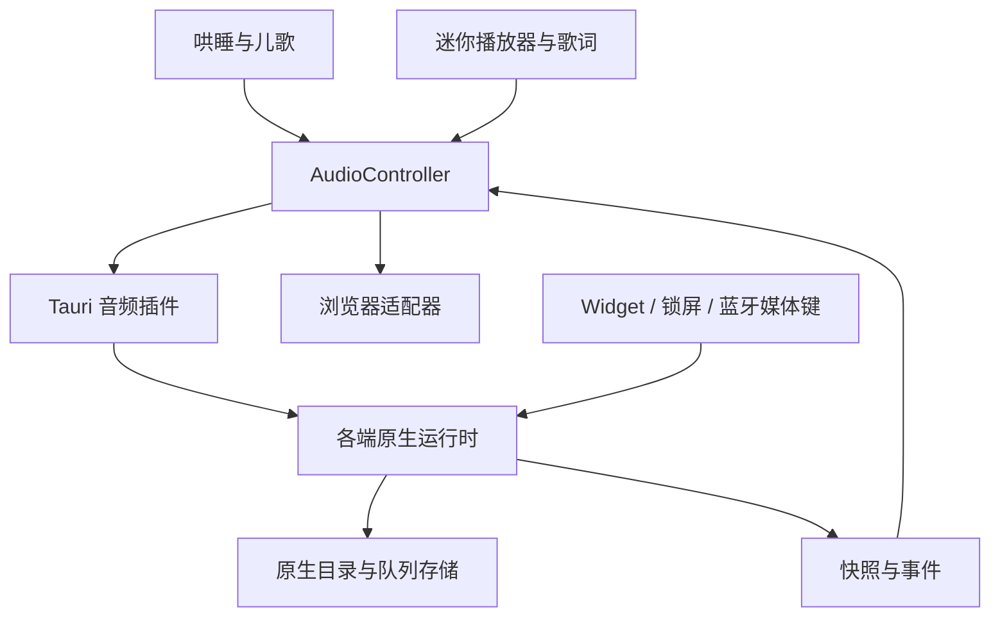

# 哄睡与儿歌：通用音频底座调研

调研日期：2026-11-17。本文是基于当前仓库与第一方资料的实现建议，尚未安装音频依赖或完成原生真机验证。

## 建议结论

使用“统一命令与状态、各端原生播放引擎”的架构。哄睡与儿歌共享设备上的一个播放会话、队列和系统媒体信息；React 负责页面、歌词与操作，原生层负责真正播放、循环、后台、定时关闭和 Widget 命令。

HTML audio 可作为浏览器降级，但不能单靠 React 和 JS 定时器实现可靠的移动端后台播放。新建独立音频插件，不继续向 native-navigation 堆业务。[Tauri 移动插件](https://v2.tauri.app/develop/plugins/develop-mobile/)

## 项目现状与复用点

| 当前代码 | 对方案的影响 |
| --- | --- |
| 正式入口 src/features/little-days/App.tsx | 播放器在应用根部初始化，页面卸载不销毁会话 |
| 历史 Journal 有附件 audio 控件 | 没有队列、后台服务和系统媒体会话，不能直接当底座 |
| src-tauri/plugins/cloud-sync 为独立原生插件 | 参考其组织方式 |
| 记录 Widget 使用快照，打开应用后交给 React | 复用 App Group、扩展与配置经验，播放命令另走原生 |
| iOS 应用最低 16.4，Widget 扩展最低 17.0 | 引擎覆盖 16.4；交互式 Widget 按 17+ 设计 |
| Android 最低 API 24，目前无 Media3 服务 | 增加媒体服务，核对依赖最低版本 |
| 桌面关闭窗口可隐藏，进程继续运行 | 可继续播放；真正退出、休眠另定义 |
| 育儿数据主要使用版本化 localStorage | 队列、素材目录和进度需要原生可读的独立存储 |
| packages/ui 已有按钮、滑杆、弹层及图标 | 优先复用公共导出，通用播放器视图再扩展共享包 |

播放初始化不应依赖宝宝档案。播放哄睡音频不自动创建睡眠记录，停止播放也不意味着宝宝醒来。

## 平台方案

| 平台 | 推荐引擎 | 后台与系统控制 | Widget |
| --- | --- | --- | --- |
| iOS | AVPlayer / AVQueuePlayer | AVAudioSession + MediaPlayer | WidgetKit + AudioPlaybackIntent |
| Android | Media3 ExoPlayer | MediaSessionService + MediaController | AppWidget 原生命令连接同一服务 |
| macOS / Windows / Linux | 评估已发布版 rodio | 单独接系统媒体键与元数据 | 桌面小组件是额外集成范围 |
| 浏览器 | HTMLAudioElement | 检测 Media Session，按能力降级 | 无原生 Widget |

### iOS

配置 .playback 音频会话与 UIBackgroundModes: audio，在真正播放时激活。通过 MPNowPlayingInfoCenter 发布封面、标题、位置与速率，通过 MPRemoteCommandCenter 接收系统命令。不要使用静音音轨或后台 JS 保活。[音频会话](https://developer.apple.com/documentation/avfaudio/avaudiosession)、[播放类别](https://developer.apple.com/documentation/avfaudio/avaudiosession/category-swift.struct/playback)、[系统播放信息](https://developer.apple.com/documentation/mediaplayer/mpnowplayinginfocenter)、[远程命令](https://developer.apple.com/documentation/mediaplayer/mpremotecommandcenter)

运行时必须能由宿主 Intent 独立创建，不能依赖 React 挂载或 Tauri 插件 load。Widget 扩展自身不再创建另一个播放器。

新 NowPlaying 框架文档标注 iOS/macOS 27 可用，不作为项目最低版本方案；未来应按版本隔离，同一会话不能混用新框架与旧 MediaPlayer 信息发布。[NowPlaying](https://developer.apple.com/documentation/nowplaying)

### Android

Player 和 MediaSession 放进 MediaSessionService，Activity/WebView 作为控制端。服务独立于 Activity 生命周期，不代表需要单独 OS 进程。声明 FOREGROUND_SERVICE、FOREGROUND_SERVICE_MEDIA_PLAYBACK 及 mediaPlayback 服务类型，由 Media3 发布媒体通知。[官方后台方案](https://developer.android.com/media/media3/session/background-playback)

启用 ExoPlayer 音频焦点处理，验证来电、抢占和耳机断开。较新 Android 目标版本对焦点申请及后台启动服务有条件；Widget 用户交互有相关豁免，但不能据此承诺任意定时唤醒或开机播放。[音频焦点](https://developer.android.com/media/optimize/audio-focus)、[后台服务限制](https://developer.android.com/develop/background-work/services/fgs/restrictions-bg-start)

媒体会话通知属于 Android 13 通知权限行为的豁免范围，不把授予普通通知权限设为所有播放的前置条件；前台服务仍须发布规定通知。[通知权限](https://developer.android.com/develop/ui/compose/notifications/notification-permission)

### 桌面与浏览器

rodio 是桌面 Rust 解码与输出候选，souvlaki 是系统媒体控制候选，两者职责不同。锁定已发布版本验证，不直接依赖开发分支。分别检查格式、macOS 事件循环、Windows 窗口句柄和 Linux D-Bus；网络流、缓存及定位播放另有成本。[rodio](https://github.com/RustAudio/rodio)、[souvlaki](https://github.com/Sinono3/souvlaki)

浏览器用相同接口并报告能力，Media Session 需检测支持；不承诺关闭页面后仍持续播放。[Media Session 标准](https://www.w3.org/TR/mediasession/)

## 社区插件评估

tauri-plugin-native-audio 可作为移动端候选：公开说明采用 AVPlayer / Media3，提供播放、暂停、定位、速率、事件与原生进度检查点。但不支持桌面，Android 最低 API 26，与项目 API 24 冲突。公开接口没有承诺完整队列、循环、渐弱定时、混音、歌词和 Widget 直接调用。[公开接口与平台要求](https://github.com/uvarov-frontend/tauri-plugin-native-audio)

先定义自己的契约，再以锁定版本验证后端。重点检查：脱离 JS 的原生入口、状态同步、原生循环/定时扩展、API 24 成本、发行版本与许可证。不默默提高最低系统版本，不把单首检查点当完整队列恢复。无法满足时实现最小自有插件或维护受控分支。当前仅核对公开资料，未完成源码全量审计、编译和真机验证。

## 模块边界

建议新增位置，以下均是规划：

- src/audio/：契约、控制器、适配器、能力检测与歌词解析。先普通模块，出现独立消费者再考虑 workspace 包。
- src/features/little-days/listening/：预设、曲库、收藏和播放页。
- packages/ui：通用 PlayerBar、SeekBar、LyricsView，公共导出，只接数据与回调，不读取育儿状态。
- src-tauri/plugins/audio-player/：Rust 入口、iOS 运行时、Android 服务、桌面适配器。
- 现有原生 Widget 工程：展示及命令入口，核心引擎不放生成工程里。

### 契约与状态

命令覆盖 loadQueue、play、pause、stop、seek、skip、setRepeat、setSleepTimer、getSnapshot、subscribe。通过 capabilities 表达混音、倍速、系统控制等是否可用。

区分 idle/loading/ready/playing/paused/buffering/ended/error，用户意图与实际输出分开记录。命令被接受不等于已经发声。

原生是唯一事实来源，所有入口进入同一串行通道。使用 sessionId、queueEntryId、revision 丢弃旧回调，命令幂等；明确 play/pause 比根据旧快照 toggle 更可靠。订阅与首次快照约定 revision，避免重开漏状态。

原生提供位置、速率、实际播放状态作为锚点；前台用本地单调时钟插值并接受校正，不相减不同进程的时间基准。不逐帧跨桥、持久化或刷新 Widget。

### 素材与持久化

统一 Track、QueueEntry、PlaybackSnapshot、SleepTimer。稳定素材 ID 在原生解析到 bundle、本地文件或网络源；Widget 不携带令牌、临时签名 URL 或 Blob URL。

文件进入应用管理目录，队列、预设、目录、进度采用原生可读的版本化存储。小规模先原子 JSON，下载索引复杂后再选数据库。音频二进制和逐秒进度不塞进育儿 localStorage、同步与备份。

导入需复制文件或正确保持访问权限。下载处理额度、完整性、重试、临时文件、淘汰及当前音轨保护。Android 可评估 Media3 下载服务，iOS 另接原生下载与索引。[离线下载](https://developer.android.com/media/media3/exoplayer/downloading-media)

## Widget 与后台边界

延续“每种类型独立小组件”的方向，提供哄睡预设、儿歌歌单、继续播放等入口，每个实例配置目标，全部控制同一个播放器。

iOS 使用 AudioPlaybackIntent，在应用进程运行，能在 WebView 未初始化时读取目录、操作运行时、更新快照再返回。不能沿用记录 Widget 打开页面等待 React 的路径。锁定设备上的 Widget 交互可能涉及认证，不能等同系统媒体按钮。[AudioPlaybackIntent](https://developer.apple.com/documentation/appintents/audioplaybackintent)、[交互及执行进程](https://developer.apple.com/documentation/widgetkit/adding-interactivity-to-widgets-and-live-activities)

Android 通过 PendingIntent/Receiver 或 MediaController 交给媒体服务，无需先启动 Activity；校验外部命令来源、媒体 ID 与可用操作，不接受任意文件地址。

原生快照包含曲目、封面、状态、进度锚点和定时截止时间。WidgetKit 刷新预算有活跃音频与用户交互例外，不是固定十五分钟一次；仍按状态变化更新，利用系统时间显示进度，不靠逐秒重载实现歌词。[Widget 更新机制](https://developer.apple.com/documentation/widgetkit/keeping-a-widget-up-to-date)

| 场景 | 预期行为 |
| --- | --- |
| 切应用、锁屏 | 原生继续播放、循环及定时 |
| React 重挂载、WebView 重建 | 重连并读取原生状态，不创建第二个引擎 |
| 来电、抢占 | 按平台焦点与中断暂停/降音量，恢复尊重用户意图 |
| 耳机断开 | 默认暂停，避免突然外放 |
| 系统终止进程 | 保存检查点，下次恢复；不能保证不中断 |
| 用户强制退出/强行停止 | 遵守 OS 限制，不承诺自动拉起 |
| 再次打开/重启 | 恢复目录与暂停状态，明确操作后播放，过期定时不重启 |

路由和中断由原生处理，不因恢复通知覆盖用户主动暂停。[路由变化](https://developer.apple.com/documentation/avfaudio/responding-to-audio-route-changes)、[音频中断](https://developer.apple.com/documentation/avfaudio/handling-audio-interruptions)

## 歌词

首版逐行同步，支持常见 LRC 和标准 WebVTT，统一为 LyricCue { startMs, endMs?, text, translation? }。处理多时间标签、正负偏移、排序、异常/空文件与乱码。WebVTT 是正式定时文本标准，LRC 作为兼容导入格式。[WebVTT](https://www.w3.org/TR/webvtt1/)

按实际位置定位活动行，拖动、倍速、缓冲和切歌后重新定位。手动滚动暂停自动跟随，提供恢复入口；保留原文、可附译文，支持大字、夜间与减少动画。逐字卡拉 OK 后续再做。

完整歌词放应用内。系统锁屏由 OS 决定布局，承诺标准封面、信息和控制，不承诺全平台自定义锁屏歌词。Widget 可展示静态当前行，不作为实时歌词播放器。

## 产品能力

### 哄睡

单轨循环、收藏预设、离线、15/30/60 分钟及播完本首停止。原生定时与结束渐弱记录截止时间及会话归属，旧定时器不能停止新队列。建议首版按实际时间截止，暂停不延长；累计播放时长是独立模式。

循环在原生完成。AVPlayerLooper 可循环队列项，但不能保证任意压缩素材无缝；需制作并验证循环素材。[AVPlayerLooper](https://developer.apple.com/documentation/avfoundation/avplayerlooper)

雨声、白噪声和摇篮曲同时播放需要单独 Mixer 能力、独立音量及资源管理。iOS 可评估 AVAudioEngine/AVAudioPlayerNode，Android 也需原生多轨方案，不能当作单播放器的小扩展。[AVAudioPlayerNode](https://developer.apple.com/documentation/avfaudio/avaudioplayernode)

### 儿歌

队列、上一首/下一首、单曲/列表循环、随机、收藏及逐行歌词。记忆位置，切页不断，首次打开不自动发声。倍速及保持音高按能力开放；语言、年龄与分类属于曲库元数据，不写死到引擎。

优先自有或授权素材。第三方平台分别确认接口、授权、离线及播放限制，不能假定能导出音频和歌词。

### 其他值得考虑的功能

睡前离线、低干扰夜间界面、大字歌词、蓝牙断连保护、剩余时间、锁屏信息隐私选项。后续扩展父母录故事、跨设备收藏、AirPlay/Cast、混音与逐字歌词；录音另有权限与素材管理职责。

音量百分比不等于宝宝实际听到的声压级，不标成“安全音量”。音频播放与育儿睡眠计时独立。

迷你播放器在根部持久显示，协调护理计时浮层、底部导航与安全区，不简单再叠固定栏。

## 实施与验收

1. 原生验证：双端本地播放、锁屏、系统控制、循环、定时、WebView 未初始化时 Widget 命令；同时判定 API 24 与候选插件。
2. 底座：状态契约、队列、原生存储、桌面/浏览器适配、能力矩阵与恢复。
3. 完整首版：第三方内容目录接入、原生下载缓存、哄睡/儿歌页面、迷你播放器、歌词及独立配置 Widget；素材接入遵循下节边界，真机验收后再称核心功能可用。
4. 扩展：多声音混音、投放和高级歌词。在线目录与下载已纳入首版，不再作为后续可选项。

验收覆盖：

- 双端真机锁屏连续 30–60 分钟，切歌、循环、渐弱定时正常。
- 来电、抢占、蓝牙和拔耳机，不突然外放或主动暂停后擅自恢复。
- Widget、锁屏、页面并发操作；重复命令、快速切歌及过期回调。
- WebView 未就绪的 Widget 命令；强制退出行为另测，不混同普通冷启动。
- 导入重启可读、离线可用，下载中断与磁盘不足可恢复。
- 歌词拖动、偏移、倍速、缓冲和异常文件，后台不逐帧渲染。
- 桌面隐藏、真正退出及系统休眠分别验证，浏览器显式降级。
- 现有记录 Widget、育儿计时、同步和备份不受影响。

实施按改动运行 pnpm check:ui、pnpm typecheck、相关前端/Rust 测试与原生构建。自动化重点是状态机、歌词、定时和命令竞态；后台必须补真机检查。

## 已确认的首版范围与本次工作

用户已确认接入第三方音乐／内容平台，并指定 Pixabay 为候选素材来源，要求下载缓存；具体接入边界见下节。哄睡首版采用单音轨循环与定时关闭，不包含多声音同时混合及分别调节音量。

以单轨循环、原生定时关闭为技术验证范围，保留导入及未来混音扩展，但首版不实现混音引擎。本次仅更新调研文档，未修改运行代码、安装依赖或执行原生 PoC。

## Pixabay 来源与下载缓存（需求更新）

用户指定资源入口：[婴儿音乐搜索](https://pixabay.com/zh/music/search/%E5%A9%B4%E5%84%BF%E9%9F%B3%E4%B9%90/)。需求确定为“Pixabay 素材来源 + 下载后离线播放”，但平台开放能力与分发授权必须分别确认。搜索页本次抓取遇到重定向循环，未据此选定曲目；以下结论来自官方 API 和授权页面。

### 授权与接入发现

Pixabay 提供的是受条件约束的免费授权，不是所有音乐都没有版权。官方摘要允许免费使用、修改且通常不要求署名，同时禁止以基本保持原样的 Standalone 形式出售或分发素材。[授权摘要](https://pixabay.com/service/license-summary/)

把原曲放进应用曲库、供播放与下载，是否属于被禁止的独立分发，当前不能直接认定获得授权。播放器界面、分类、循环或缓存不能自动证明构成新创作。对这种产品形态，建议取得 Pixabay 或有权授权者明确覆盖应用播放、托管及离线副本的许可，再发布相应曲库；这是本次基于条款的判断，不是平台已批准该应用。[完整条款第 5 节](https://pixabay.com/service/terms/)

官方公开 API 文档目前覆盖图片和视频，未提供音乐搜索、音乐下载接口。不能把图片 API 的 music 分类当作音乐接口，也不能把图片热链规则推广为音频托管许可。[官方 API](https://pixabay.com/api/docs/)

条款限制未经授权的自动提取与系统性复制，因此不采用爬搜索页面、逆向下载接口或批量抓取的方式建立曲库。[服务使用条款第 8 节](https://pixabay.com/service/terms/)

### 推荐素材流程

1. 人工精选少量曲目，记录原作品页、作者、素材 ID、获取日期、许可版本及可获得的许可证明。
2. 确认应用分发及离线使用权限；获得许可后，使用获准的官方交付方式，或自行托管获准分发的文件和版本化目录。不假定有音乐 API，也不硬编码站点临时音频地址。
3. 目录包含 provider、sourceId、sourcePageUrl、author、licenseRef、assetVersion、sha256、byteSize、durationMs、mimeType、获准的 downloadUrl 和可选歌词引用。许可证明存管理侧，不在客户端暴露凭据。
4. 应用显示来源与作者入口；即使一般许可不强制署名，也保留可追溯信息。曲目音频、封面和歌词分别确认来源，纯音乐正常显示“暂无歌词”。
5. 提供曲目停发与版本撤回机制；不再向新用户下发有争议素材。离线设备无法即时接收撤回，不把远程开关描述成实时保证。

在分发权限确认前，可以继续建设通用播放器及下载器，用自有测试音频验证；保留“前往 Pixabay 获取文件后导入”的路径，但不能据此声称平台授权了任意用户用途。

### 缓存设计

- 区分自动缓存与用户点击的“下载离线”。自动缓存按额度淘汰，明确下载默认保留，提供空间统计、删除单首和清理缓存；清缓存不误删明确下载。
- 首版建议整文件下载后播放，简化离线校验与恢复；边下边播后续根据需要增加，不能把不完整文件标成已下载。
- 下载由原生执行，状态为 queued/downloading/paused/completed/failed；支持取消、重试和应用重开后恢复。支持断点的前提是服务器 Range、ETag/版本等条件满足，否则安全重下。
- 写临时文件，校验长度及摘要后原子转为可播放文件，索引再标完成。以素材 ID + 版本定位，避免同名冲突；正在播放或下载的文件不淘汰。
- Wi-Fi 下载偏好、并发限制、空间不足提示和失败重试均由统一下载服务管理；后台执行仍遵循各端系统条件，不能仅靠网页 fetch。
- Widget 传素材 ID，原生优先解析完整本地副本；未下载且离线时返回明确不可用状态。断网、签名链接过期、文件损坏、磁盘不足均应列入验收。

下载离线是已确定需求；“合法可分发的素材来源”与“下载缓存工程能力”分开推进，避免把技术上能下载当作拥有分发权限。

## 实施进展

播放器已进入实现阶段；当前代码入口、实际首版边界和验证方式见 [实现说明](audio-player.md)。本文前面的调研建议不表示全部扩展能力已经落地。

2026-11-18：用户确认改用 CC0／公有领域录音。当前内置资源已改为随应用打包、应用内播放与缓存，具体来源见 [内置音频目录](audio-catalog.md)。前文 Pixabay 分发限制保留为调研记录，不再作为当前曲库的接入方式。
